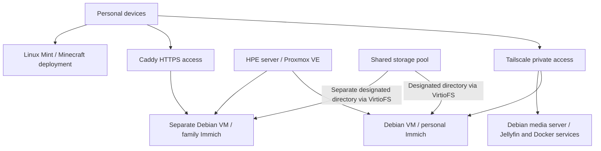

[Documentation](README.md) | [Configs](../configs/README.md) | [README](../README.md)

# Homelab architecture

This diagram summarizes roles described in the project chats. It does not establish the current placement of every service.

## Storage and isolation

The later Proxmox summary reported roughly 188 GiB of host memory and a roughly 21 TiB storage filesystem. Separate VMs, databases, accounts, and photo directories were used for two Immich deployments. VirtioFS mappings provided each VM with its designated directory.

An older topology described a third Immich deployment as planned. No completion evidence for that third deployment was available in the reviewed summaries. The older RAID6 plan should not be treated as evidence of the final controller configuration.

## Placement caveats

Earlier documentation places Jellyfin on a dedicated Debian machine and Minecraft on Linux Mint. A later summary mentions multiple VMs supporting photo management, media, and Minecraft without establishing all migration details. Verify placement before treating this diagram as an operational inventory.
